<div align="center">

# Cryptography and Blockchain Fundamentals

**A menu-driven console application for SHA-256 hashing, RSA digital signatures and a vehicle registration system**

   


[Overview](#overview) · [Requirements](#requirements-traceability) · [Quick start](#quick-start) · [Tour](#application-tour) · [SHA-256](#feature-1-sha-256-hashing) · [Signatures](#feature-2-digital-signature) · [Registry](#feature-3-vehicle-registration-system) · [Validation](#input-validation-and-error-handling) · [Architecture](#software-architecture) · [Tests](#test-matrix) · [References](#references)

</div>

---

## Overview

This repository contains a single-file Python console program that combines three small but fundamental ideas from applied cryptography and blockchain systems: a cryptographic hash function, a public-key digital signature scheme and a keyed registry of records. When it starts, the program enters a loop that prints a numbered menu, reads the user's choice, executes the corresponding action and returns to the menu, until the user selects *Exit*.

The program implements exactly the functionality required by the assignment and nothing beyond it. The engineering around that functionality is nevertheless deliberately professional: the code is fully type-annotated and passes `mypy --strict`, console input and output are kept apart from the cryptographic and registry logic, the menu is an `IntEnum`, actions are dispatched through a lookup table instead of an `if`/`elif` ladder, records are immutable slotted dataclasses, and domain errors are reported through a small exception hierarchy.

### At a glance

| Aspect                 | Detail                                                                                                         |
| ---------------------- | -------------------------------------------------------------------------------------------------------------- |
| Language               | Python 3.10 or newer                                                                                           |
| Entry point            | `crypto_blockchain_app.py`, function `main()`                                                                  |
| Hash function          | SHA-256 (FIPS 180-4) through `hashlib`                                                                         |
| Signature scheme       | RSASSA-PSS (RFC 8017) with a 2048-bit modulus, public exponent 65537, SHA-256, MGF1-SHA-256 and a 32-byte salt |
| Vehicle storage        | In-memory `dict`, keyed by the canonical number plate                                                          |
| Third-party dependency | `cryptography`                                                                                                 |
| Interface              | Console menu with five entries, printed again after every action                                               |

### Relationship to blockchain concepts

The three components correspond to primitives that underlie every blockchain. A chain of blocks is bound together by hash pointers, $h_i = \mathrm{SHA256}(h_{i-1} \,\Vert\, d_i)$, so that changing the data $d_j$ of an earlier block changes every later $h_i$ with overwhelming probability. Transactions $\tau$ are authenticated by digital signatures $\sigma = \mathrm{Sign}_{sk}(\tau)$ that anybody can check against the public key $pk$, and the system as a whole maintains a registry of state. This project implements the first two primitives and a plain registry in isolation, exactly as the assignment specifies. It does not implement a chain of blocks, and the vehicle registry is an ordinary dictionary rather than a ledger.

## Requirements traceability

Every requirement of the assignment maps to a concrete piece of code.

| Assignment requirement                                                                               | Implementation in `crypto_blockchain_app.py`                                                                           | Menu entry |
| ---------------------------------------------------------------------------------------------------- | ---------------------------------------------------------------------------------------------------------------------- | ---------- |
| Menu-driven application using a loop; the menu is shown every time and the chosen action is executed | `Application.run()` loops forever, calls `_show_menu()` and `_read_option()`, then executes `self._handlers[option]()` | all        |
| SHA-256 hash of a message typed by the user                                                          | `sha256_hex()`, called from `Application._hash_message()`                                                              | 1          |
| Generate a public-private key pair                                                                   | `SignatureScheme.generate_key_pair()`, which returns a `KeyPair`                                                       | 2          |
| Input a message to sign                                                                              | `Application._sign_and_verify()` reads the message with `input()`                                                      | 2          |
| Sign the message with the private key                                                                | `SignatureScheme.sign()`                                                                                               | 2          |
| Verify with the public key and display whether the signature is valid                                | `SignatureScheme.verify()`, followed by printing `VALID` or `INVALID`                                                  | 2          |
| Store a vehicle (number plate, owner, model) in a dictionary                                         | `VehicleRegistry.register()`, writing into `self._vehicles`                                                            | 3          |
| Retrieve the owner and model by number plate                                                         | `VehicleRegistry.get()` and `Application._get_vehicle()`                                                               | 4          |
| Suitable error message when the number plate is not found                                            | `VehicleNotFoundError`, caught in `Application._get_vehicle()`                                                         | 4          |
| Input validation: no duplicate number plate                                                          | `VehicleRegistry.ensure_available()` raises `DuplicateVehicleError`, caught in `Application._register_vehicle()`       | 3          |

## Quick start

You need Python 3.10 or newer and the `cryptography` package (release 3.1 or later; the project was exercised with 46.0.6). Everything else comes from the standard library.

```bash
git clone https://github.com/<your-username>/<your-repository>.git
cd <your-repository>

# optional but recommended: an isolated environment
python -m venv .venv
source .venv/bin/activate            # Windows PowerShell: .venv\Scripts\Activate.ps1

pip install cryptography
python crypto_blockchain_app.py      # use python3 if python is not on your PATH
```

A minimal repository layout looks like this.

```text
.
├── crypto_blockchain_app.py   # the complete application
└── README.md                  # this document
```

## Application tour

Starting the program prints the menu below. After every action, including actions that end in an error message, the menu is printed again.

```text
================================================
     Cryptography & Blockchain Fundamentals     
================================================
  1. Generate SHA-256 hash of a message
  2. Create and verify a digital signature
  3. Register a vehicle
  4. Retrieve vehicle details
  5. Exit
------------------------------------------------
Enter your choice: 
```

| Menu entry                               | Prompts                                                            | Output                                                                                                             |
| ---------------------------------------- | ------------------------------------------------------------------ | ------------------------------------------------------------------------------------------------------------------ |
| 1. Generate SHA-256 hash of a message    | `Enter the message to hash:`                                       | `SHA-256: ` followed by 64 hexadecimal digits                                                                      |
| 2. Create and verify a digital signature | a key pair is generated, then `Enter the message to sign:`         | `Public-private key pair generated (RSA-2048).`, the signature in hexadecimal and the verdict `VALID` or `INVALID` |
| 3. Register a vehicle                    | `Enter Number Plate:`, `Enter Owner Name:`, `Enter Vehicle Model:` | a success line, or an error if the number plate is already registered                                              |
| 4. Retrieve vehicle details              | `Enter Number Plate:`                                              | the number plate, owner and model, or an error if the number plate is unknown                                      |
| 5. Exit                                  | none                                                               | `Goodbye!`                                                                                                         |

### A complete session

The transcript below was captured from a real run. The repeated menu is abbreviated to `[menu printed again]`, and the signature is cut after 32 hexadecimal digits (the real output contains 512 digits and differs on every run because the scheme is probabilistic).

```text
================================================
     Cryptography & Blockchain Fundamentals     
================================================
  1. Generate SHA-256 hash of a message
  2. Create and verify a digital signature
  3. Register a vehicle
  4. Retrieve vehicle details
  5. Exit
------------------------------------------------
Enter your choice: 1
Enter the message to hash: Hello, Blockchain!
SHA-256: 7526b1d2bc17587443fbf1fafb27e95d70615bc7576c6e34c1f139c9ce857733

[menu printed again]
Enter your choice: 2
Public-private key pair generated (RSA-2048).
Enter the message to sign: Transfer 10 coins to Alice
Signature (hex): 6ffd35a393acd7a452ec76a8c7175c78…
Signature verification: VALID

[menu printed again]
Enter your choice: 3
Enter Number Plate: WB01AB1234
Enter Owner Name: Riya Sen
Enter Vehicle Model: Hyundai i20
Vehicle WB01AB1234 registered successfully.

[menu printed again]
Enter your choice: 3
Enter Number Plate: wb 01 ab 1234
Error: Number plate 'WB01AB1234' is already registered.

[menu printed again]
Enter your choice: 4
Enter Number Plate: wb01ab1234
Number Plate: WB01AB1234
Owner:        Riya Sen
Model:        Hyundai i20

[menu printed again]
Enter your choice: 4
Enter Number Plate: KA01XX0001
Error: No vehicle found with number plate 'KA01XX0001'.

[menu printed again]
Enter your choice: 5
Goodbye!
```

The control flow behind this transcript is shown below. The loop prints the menu, reads a choice and either rejects it, leaves the program, or dispatches to one of the four handlers. An interrupt or the end of the input stream at any prompt leaves the loop through `main()`.

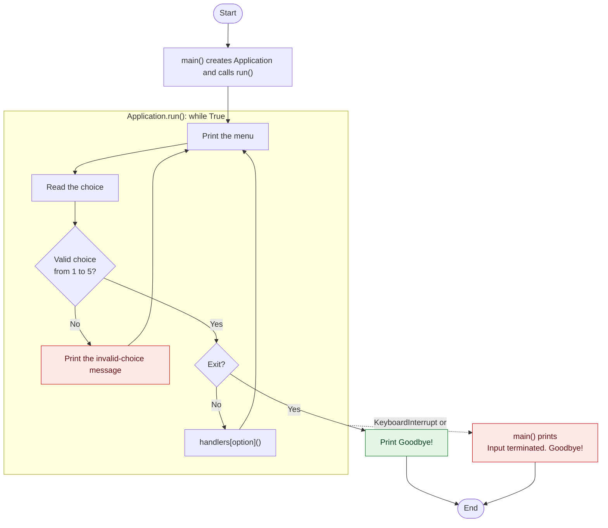

## Feature 1: SHA-256 hashing

Menu entry 1 asks for a message, encodes it as UTF-8 and prints the SHA-256 digest as 64 lowercase hexadecimal digits. The message is taken verbatim: leading and trailing spaces belong to the input and therefore change the digest, and an empty message is allowed. Encoding to bytes explicitly fixes the byte representation, so the result does not depend on the default encoding of the platform.

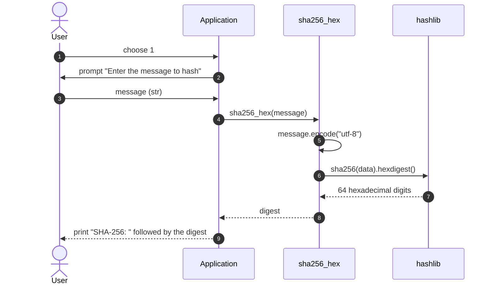

### Known answers and the avalanche effect

| Message              | SHA-256 digest                                                     |
| -------------------- | ------------------------------------------------------------------ |
| empty string         | `e3b0c44298fc1c149afbf4c8996fb92427ae41e4649b934ca495991b7852b855` |
| `abc`                | `ba7816bf8f01cfea414140de5dae2223b00361a396177a9cb410ff61f20015ad` |
| `hello`              | `2cf24dba5fb0a30e26e83b2ac5b9e29e1b161e5c1fa7425e73043362938b9824` |
| `Hello`              | `185f8db32271fe25f561a6fc938b2e264306ec304eda518007d1764826381969` |
| `Hello, Blockchain!` | `7526b1d2bc17587443fbf1fafb27e95d70615bc7576c6e34c1f139c9ce857733` |

The inputs `hello` and `Hello` differ in a single bit (`0x68` versus `0x48`, a difference of `0x20`), yet their digests differ in 125 of the 256 bit positions, close to the 128 positions expected from an ideal random function. This is the avalanche effect. It is also the reason a hash can serve as a tamper-evident fingerprint: any change to the message, however small, produces an unrelated digest.

<details>
<summary><strong>Formal specification of SHA-256 (FIPS 180-4)</strong></summary>

&nbsp;

Let $\boxplus$ denote addition modulo $2^{32}$, $\oplus$ bitwise exclusive-or, $\wedge$ bitwise and, $\neg$ bitwise complement, $\mathrm{ROTR}^{s}$ a right rotation of a 32-bit word by $s$ positions and $\mathrm{SHR}^{s}$ a logical right shift by $s$ positions. A message $M$ of $\ell$ bits is first padded,

$$\mathrm{pad}(M) = M \,\Vert\, 1 \,\Vert\, 0^{k} \,\Vert\, \langle \ell \rangle_{64}, \qquad k \equiv 447 - \ell \pmod{512},\quad 0 \le k < 512,$$

so that $\mathrm{pad}(M) = M^{(1)} \Vert \cdots \Vert M^{(N)}$ consists of $N = \lceil (\ell + 65)/512 \rceil$ blocks of 512 bits. Each block is parsed into sixteen 32-bit words. Starting from the initial value $H^{(0)}$ (the first 32 bits of the fractional parts of the square roots of the first eight primes), every block updates the eight-word state wordwise,

$$H^{(i)} = H^{(i-1)} \boxplus \mathrm{Compress}\bigl(H^{(i-1)}, M^{(i)}\bigr), \qquad 1 \le i \le N,$$

and the digest is the concatenation of the final state words,

$$\mathrm{SHA256}(M) = H^{(N)}_0 \,\Vert\, H^{(N)}_1 \,\Vert\, \cdots \,\Vert\, H^{(N)}_7 \in \{0,1\}^{256}.$$

The compression function first expands the block into a 64-word message schedule,

$$W_t = \begin{cases} M^{(i)}_t & 0 \le t \le 15, \\ \sigma_1(W_{t-2}) \boxplus W_{t-7} \boxplus \sigma_0(W_{t-15}) \boxplus W_{t-16} & 16 \le t \le 63, \end{cases}$$

then initialises $(a,b,c,d,e,f,g,h) = H^{(i-1)}$ and performs 64 rounds, $t = 0, \dots, 63$, where $K_0, \dots, K_{63}$ are the first 32 bits of the fractional parts of the cube roots of the first 64 primes,

$$\begin{aligned}
T_1 &= h \boxplus \Sigma_1(e) \boxplus \mathrm{Ch}(e,f,g) \boxplus K_t \boxplus W_t, \\
T_2 &= \Sigma_0(a) \boxplus \mathrm{Maj}(a,b,c), \\
(a,b,c,d,e,f,g,h) &\leftarrow (T_1 \boxplus T_2,\ a,\ b,\ c,\ d \boxplus T_1,\ e,\ f,\ g).
\end{aligned}$$

The value $\mathrm{Compress}(H^{(i-1)}, M^{(i)})$ is the final $(a, \dots, h)$. The Boolean and rotation functions are

$$\begin{aligned}
\mathrm{Ch}(x,y,z) &= (x \wedge y) \oplus (\neg x \wedge z), &
\Sigma_0(x) &= \mathrm{ROTR}^{2}(x) \oplus \mathrm{ROTR}^{13}(x) \oplus \mathrm{ROTR}^{22}(x), \\
\mathrm{Maj}(x,y,z) &= (x \wedge y) \oplus (x \wedge z) \oplus (y \wedge z), &
\Sigma_1(x) &= \mathrm{ROTR}^{6}(x) \oplus \mathrm{ROTR}^{11}(x) \oplus \mathrm{ROTR}^{25}(x), \\
\sigma_0(x) &= \mathrm{ROTR}^{7}(x) \oplus \mathrm{ROTR}^{18}(x) \oplus \mathrm{SHR}^{3}(x), &
\sigma_1(x) &= \mathrm{ROTR}^{17}(x) \oplus \mathrm{ROTR}^{19}(x) \oplus \mathrm{SHR}^{10}(x).
\end{aligned}$$

Against generic attacks, finding a collision costs about $2^{128}$ evaluations (the birthday bound), and finding a preimage or a second preimage costs about $2^{256}$.

</details>

## Feature 2: Digital signature

Menu entry 2 runs the complete life cycle of a digital signature in one action. It generates a fresh public-private key pair, asks for a message, signs the message with the private key, verifies the signature with the public key and prints the verdict. The key pair is never printed or stored: it exists only for the duration of this action.

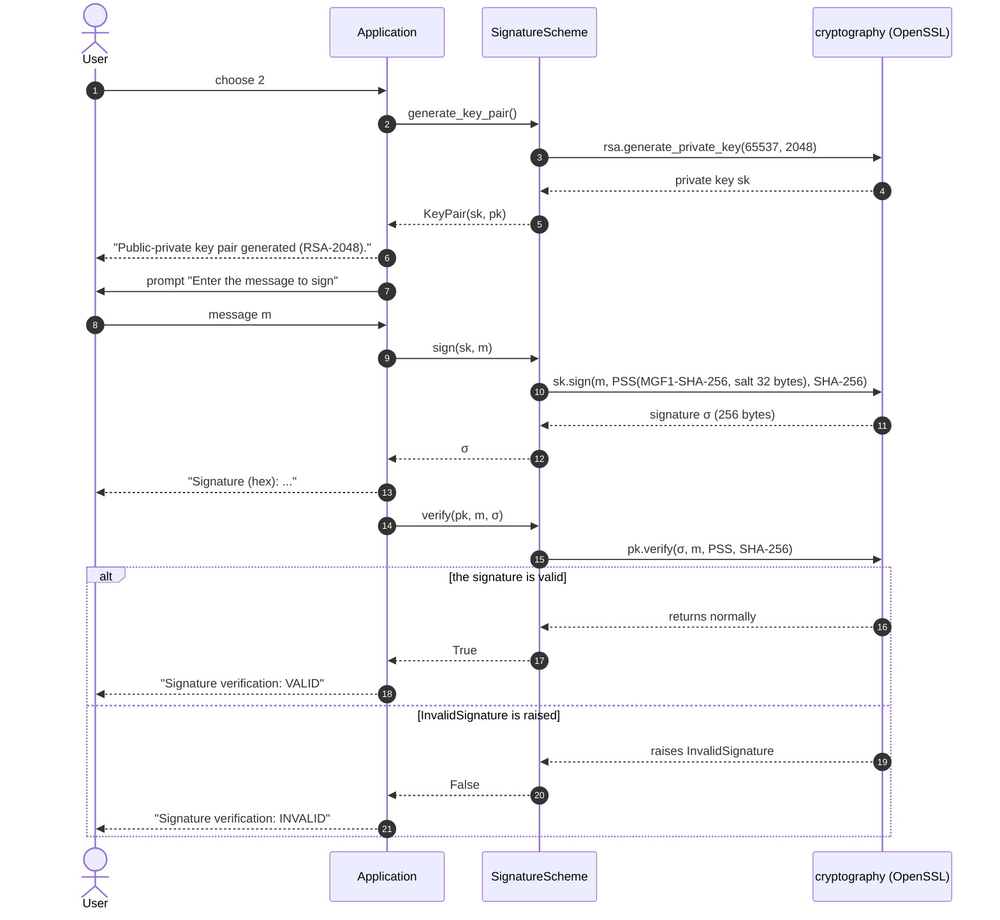

### Parameters

| Parameter                | Value                                        | Defined by                       |
| ------------------------ | -------------------------------------------- | -------------------------------- |
| Scheme                   | RSASSA-PSS, RFC 8017 section 8.1             | `SignatureScheme`                |
| Modulus size             | 2048 bits                                    | `KEY_SIZE_BITS`                  |
| Public exponent          | 65537 = 2^16 + 1                             | `PUBLIC_EXPONENT`                |
| Message hash             | SHA-256                                      | `_HASH`                          |
| Mask generation function | MGF1 with SHA-256                            | `_PADDING`                       |
| Salt length              | 32 bytes, equal to the digest length         | `_PADDING`                       |
| Signature length         | 256 bytes, printed as 512 hexadecimal digits | determined by the modulus        |
| Key lifetime             | one run of menu entry 2                      | `Application._sign_and_verify()` |

### How RSASSA-PSS signs

The scheme signs a hash of the message, never the raw message. A random salt is mixed into an encoded message $EM$ of exactly as many bits as the modulus allows, and only then is the private exponent applied. The diagram follows the encoding of RFC 8017 section 9.1.1 with the byte lengths that result from the parameters above.

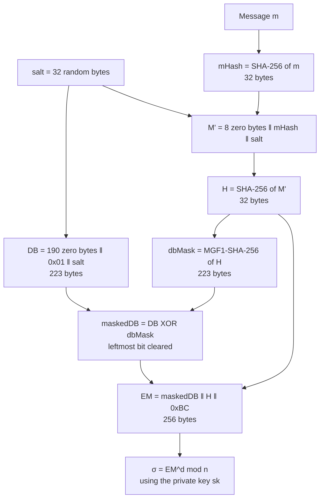

### How RSASSA-PSS verifies

Verification undoes the public-key operation, checks the structure of the recovered encoding and recomputes the hash with the salt that the signer embedded. The signature is accepted only if every check passes.

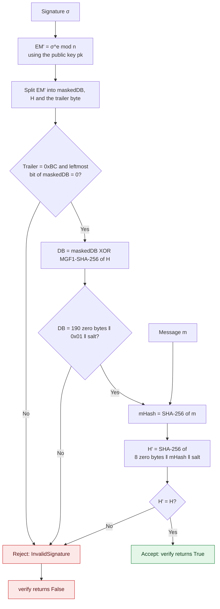

<details>
<summary><strong>Formal description, correctness proof and security statement</strong></summary>

&nbsp;

Write $\mathsf{Enc}(m, s)$ for EMSA-PSS-ENCODE and $\mathsf{Chk}(m, EM')$ for EMSA-PSS-VERIFY (RFC 8017, section 9.1); the conversions I2OSP and OS2IP between octet strings and integers are left implicit. The scheme is the triple $(\mathrm{KeyGen}, \mathrm{Sign}, \mathrm{Vf})$ with

$$\mathrm{KeyGen}(1^{2048}):\quad p \neq q \text{ primes},\ \ n = pq,\ \ e = 65537,\ \ d \equiv e^{-1} \pmod{\lambda(n)},\ \ \lambda(n) = \mathrm{lcm}(p-1,\, q-1),$$

$$pk = (n, e), \qquad sk = (n, d), \qquad 2^{2047} \le n < 2^{2048},$$

$$\mathrm{Sign}(sk, m):\quad s \leftarrow_R \{0,1\}^{256}, \quad EM = \mathsf{Enc}(m, s), \quad \sigma = EM^{d} \bmod n,$$

$$\mathrm{Vf}(pk, m, \sigma):\quad EM' = \sigma^{e} \bmod n, \quad \text{accept} \iff \mathsf{Chk}(m, EM') = 1.$$

For the parameters of this program ($\mathit{emBits} = 2047$, $\mathit{emLen} = 256$, $\mathit{sLen} = \mathit{hLen} = 32$) the encoding is

$$\begin{aligned}
\mathit{mHash} &= \mathrm{SHA256}(m), \\
M' &= 0^{64} \,\Vert\, \mathit{mHash} \,\Vert\, s, \qquad H = \mathrm{SHA256}(M'), \\
DB &= 0^{8 \cdot 190} \,\Vert\, \mathtt{01} \,\Vert\, s, \\
\mathit{maskedDB} &= DB \oplus \mathrm{MGF1}_{\mathrm{SHA256}}(H, 223) \quad \text{with the leftmost bit set to } 0, \\
EM &= \mathit{maskedDB} \,\Vert\, H \,\Vert\, \mathtt{BC},
\end{aligned}$$

so that $\lvert DB \rvert = 190 + 1 + 32 = 223$ bytes and $\lvert EM \rvert = 223 + 32 + 1 = 256$ bytes. Because the leftmost bit of $EM$ is zero, $0 \le \mathrm{OS2IP}(EM) < 2^{2047} \le n$, so $EM$ is a valid residue modulo $n$.

**Theorem (correctness).** For every key pair produced by $\mathrm{KeyGen}$ and every message $m$, $\mathrm{Vf}(pk, m, \mathrm{Sign}(sk, m)) = 1$.

*Proof.* Since $ed \equiv 1 \pmod{\lambda(n)}$, write $ed = 1 + k\,\lambda(n)$ with $k \in \mathbb{N}$. Let $x$ be any integer. If $p \mid x$, then $x^{ed} \equiv 0 \equiv x \pmod p$. Otherwise Fermat's little theorem gives $x^{p-1} \equiv 1 \pmod p$, and because $(p-1) \mid \lambda(n)$,

$$x^{ed} = x \cdot \bigl(x^{\lambda(n)}\bigr)^{k} \equiv x \pmod p.$$

The same argument applies modulo $q$, and as $p \neq q$ the Chinese remainder theorem yields $x^{ed} \equiv x \pmod n$ for every integer $x$. Taking $x = EM$ gives $\sigma^{e} = EM^{de} \equiv EM \pmod n$. Because $0 \le EM < n$, the verifier recovers $EM' = EM$ exactly. It therefore finds the same $H$, the same salt $s$ and the same $\mathit{mHash}$, recomputes $H' = \mathrm{SHA256}(0^{64} \Vert \mathit{mHash} \Vert s) = H$, and accepts. $\blacksquare$

**Randomised signing.** The salt $s$ is drawn afresh for every signature, so $\mathrm{Sign}$ is probabilistic: two signatures on the same message under the same key differ with overwhelming probability, yet both are accepted by $\mathrm{Vf}$, which is deterministic.

**Security.** Modelling the hash function inside $\mathsf{Enc}$ as a random oracle, RSASSA-PSS is existentially unforgeable under adaptive chosen-message attacks assuming the RSA problem is hard (Bellare and Rogaway, 1996; tight reduction by Coron, 2002). A 2048-bit modulus corresponds to roughly 112 bits of security strength according to NIST SP 800-57 Part 1.

</details>

### Using the signature functions directly

The module can be imported without starting the menu, which makes the failure paths of verification easy to reproduce.

```python
from crypto_blockchain_app import SignatureScheme

keys = SignatureScheme.generate_key_pair()
message = b"Transfer 10 coins to Alice"
signature = SignatureScheme.sign(keys.private_key, message)

print(SignatureScheme.verify(keys.public_key, message, signature))                        # True
print(SignatureScheme.verify(keys.public_key, b"Transfer 90 coins to Alice", signature))  # False

other_keys = SignatureScheme.generate_key_pair()
print(SignatureScheme.verify(other_keys.public_key, message, signature))                  # False
```

| Scenario                                           | `verify()` returns | Reason                                                                                |
| -------------------------------------------------- | ------------------ | ------------------------------------------------------------------------------------- |
| Matching key pair, untouched message and signature | `True`             | By the correctness theorem, σ^e mod n returns EM and the recomputed hash equals H     |
| Message altered, even by one bit                   | `False`            | mHash changes, so the recomputed H' differs from H except with negligible probability |
| Signature altered, even by one bit                 | `False`            | σ^e mod n becomes an unrelated integer whose encoding fails the structural checks     |
| Different public key                               | `False`            | The exponentiation uses another modulus and again yields an unrelated integer         |

Inside the menu action the message, the signature and the key pair are consistent by construction, so the verdict displayed there is always `VALID`.

## Feature 3: Vehicle Registration System

Menu entries 3 and 4 form a small registry. A vehicle consists of a number plate, an owner name and a model, and the registry maps each number plate to exactly one vehicle. Registration refuses a number plate that is already present, and retrieval reports a clear error for an unknown one.

### Canonical number plates

Two plates that differ only in letter case or whitespace denote the same physical plate, so the registry compares *canonical* plates: all whitespace is removed and the remainder is upper-cased. The canonical form is the dictionary key and is also the form shown in messages.

| Typed by the user | Canonical key used for storage and lookup |
| ----------------- | ----------------------------------------- |
| `WB01AB1234`      | `WB01AB1234`                              |
| `wb01ab1234`      | `WB01AB1234`                              |
| `wb 01 ab 1234`   | `WB01AB1234`                              |
| `WB-01-AB-1234`   | `WB-01-AB-1234`                           |

Only case and whitespace are normalised; other punctuation such as the hyphens in the last row remains significant.

### Formal model

Let $\kappa$ be the canonicalisation map, $V$ the set of vehicle records and $R : \Sigma^{*} \rightharpoonup V$ the registry, a partial function that is nowhere defined at the start. The two operations are

$$\mathrm{register}(p, o, m) = \begin{cases} R \leftarrow R \cup \{\kappa(p) \mapsto (\kappa(p), o, m)\} & \kappa(p) \notin \mathrm{dom}(R), \\ \text{raise } \mathrm{DuplicateVehicleError} & \kappa(p) \in \mathrm{dom}(R), \end{cases}$$

$$\mathrm{get}(p) = \begin{cases} R(\kappa(p)) & \kappa(p) \in \mathrm{dom}(R), \\ \text{raise } \mathrm{VehicleNotFoundError} & \text{otherwise.} \end{cases}$$

Three invariants hold. First, $\kappa$ is idempotent, $\kappa(\kappa(p)) = \kappa(p)$, so a canonical key that is canonicalised again, as happens between the early duplicate check and the final insertion, does not change. Second, every stored record satisfies $R(k).\mathrm{number\_plate} = k$. Third, no operation deletes or overwrites an entry, so $\mathrm{dom}(R)$ only grows and a number plate can never belong to two vehicles. The per-plate life cycle is therefore the following machine.

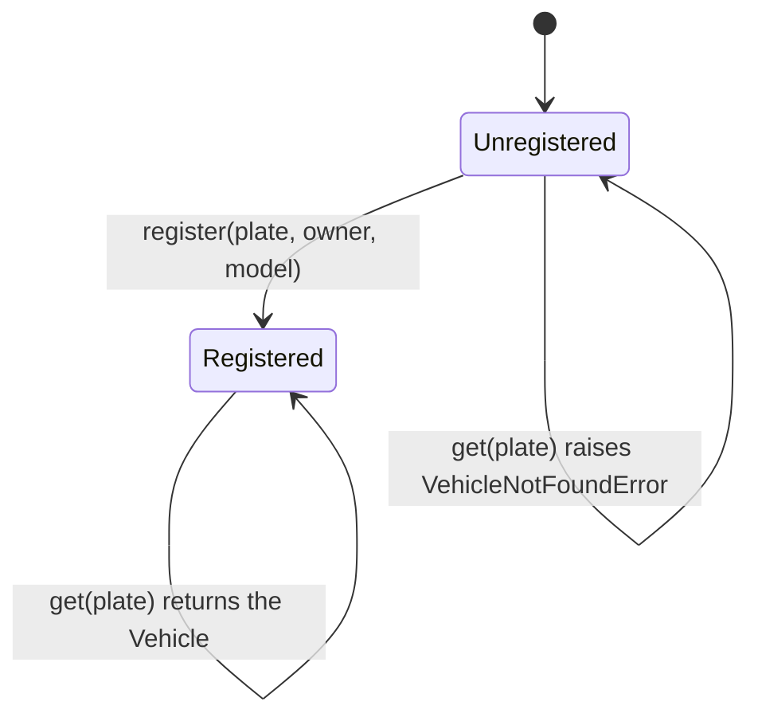

### Registration flow

The number plate is requested first and checked immediately, so the user is never asked for an owner and model that would be rejected anyway.

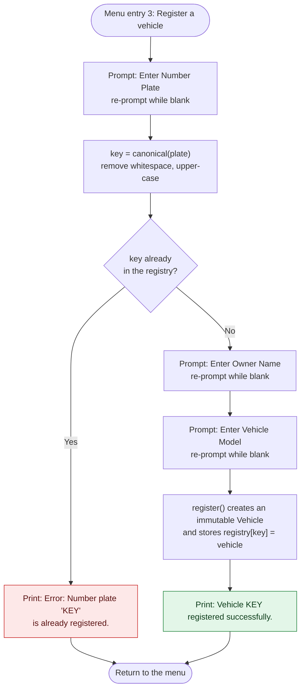

### Retrieval flow

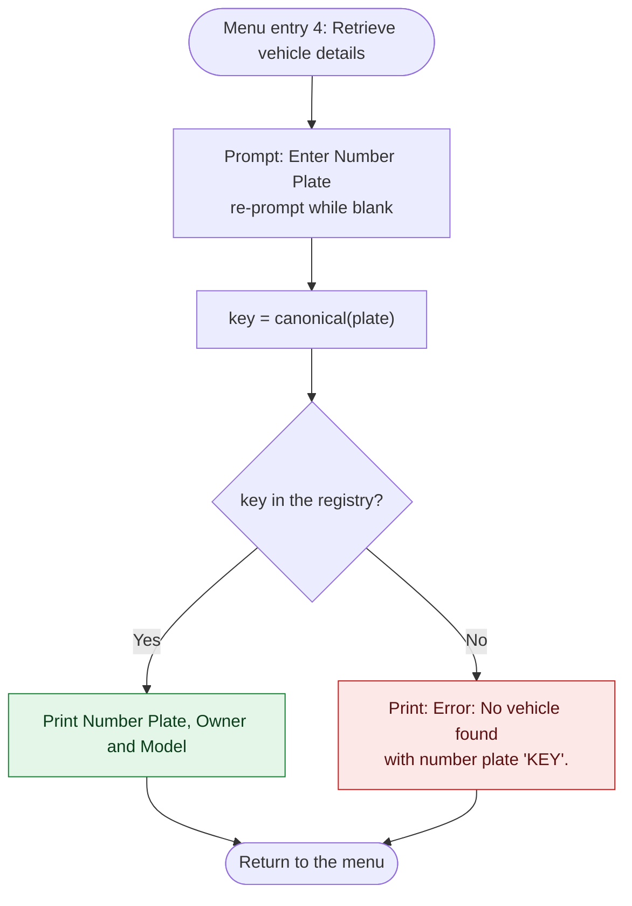

### Messages

| Situation                       | Output                                                      |
| ------------------------------- | ----------------------------------------------------------- |
| Registration succeeds           | `Vehicle WB01AB1234 registered successfully.`               |
| Number plate already registered | `Error: Number plate 'WB01AB1234' is already registered.`   |
| Retrieval succeeds              | three lines labelled `Number Plate:`, `Owner:` and `Model:` |
| Number plate unknown            | `Error: No vehicle found with number plate 'XX99'.`         |

## Input validation and error handling

All user input is validated at the console layer or by the registry, and every failure ends in a readable message followed by the menu rather than a traceback.

| Input                                                 | Rule                                                         | Behaviour when violated                                                                                                      |
| ----------------------------------------------------- | ------------------------------------------------------------ | ---------------------------------------------------------------------------------------------------------------------------- |
| Menu choice                                           | Must parse as an integer from 1 to 5                         | `Invalid choice. Enter a number from 1 to 5.`, then the menu is printed again                                                |
| Number plate when registering                         | Not blank, and its canonical form must not be registered yet | Blank: the prompt is repeated. Duplicate: `Error: Number plate '…' is already registered.`, and no further prompts are shown |
| Owner name and model when registering                 | Not blank                                                    | The prompt `  This field cannot be empty. Please try again.` is shown and the question is repeated                           |
| Number plate when retrieving                          | Not blank, and it must exist                                 | Blank: the prompt is repeated. Unknown: `Error: No vehicle found with number plate '…'.`                                     |
| Messages to hash or sign                              | Any text, taken verbatim and possibly empty                  | none needed                                                                                                                  |
| Ctrl+C, or the end of the input stream, at any prompt | none                                                         | The program ends cleanly with `Input terminated. Goodbye!`                                                                   |

Free-text vehicle fields are stripped of surrounding whitespace and must contain at least one visible character. The helper `read_required()` implements this rule once for all three vehicle prompts.

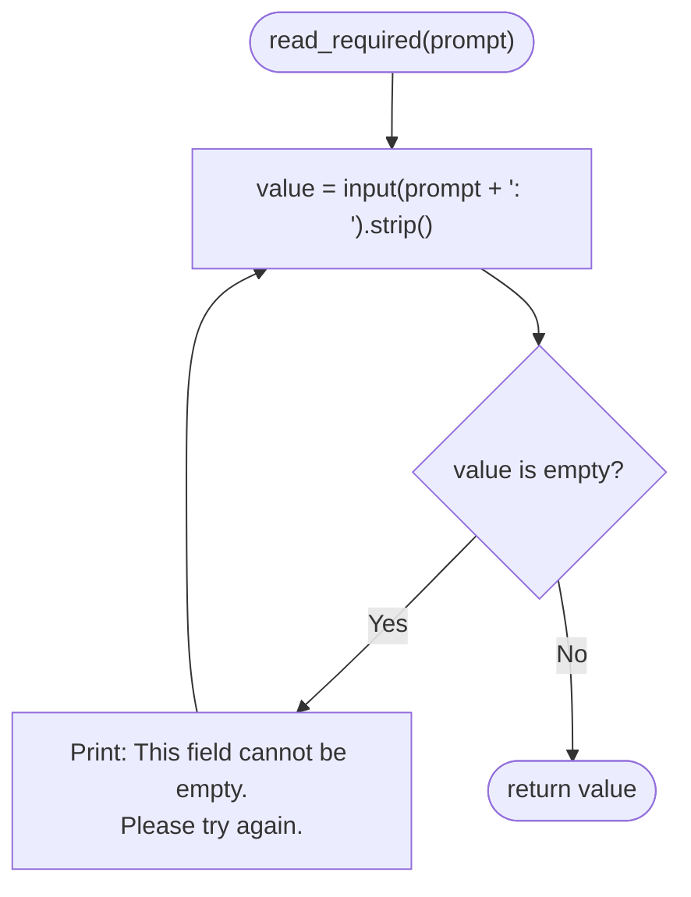

Domain errors are modelled as exceptions that the console layer catches and words for the user. The hierarchy has a common base class so that all registry errors can be handled together if needed.

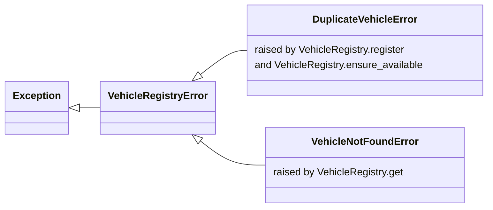

## Software architecture

The module is organised in four sections that are separated by banner comments: hashing, digital signature, vehicle registry and console interface. The console layer depends on the service layer and never the other way round. The services contain no `print` or `input` call, so they can be imported and exercised without any console interaction.

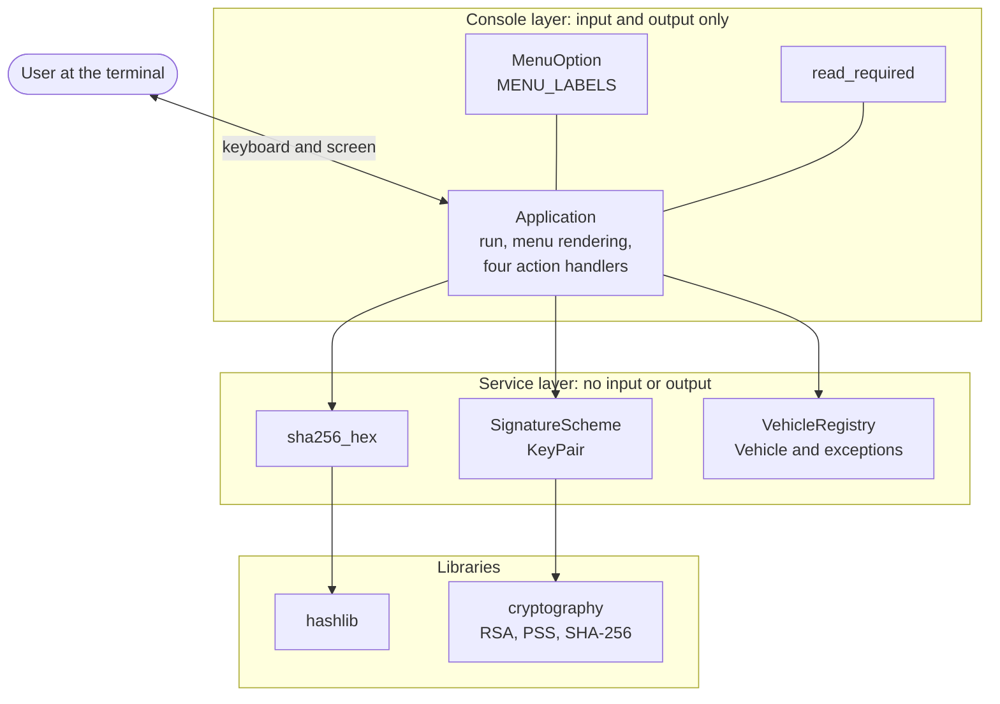

### Class diagram

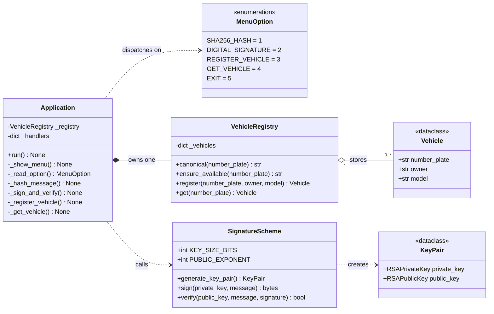

### Dependencies

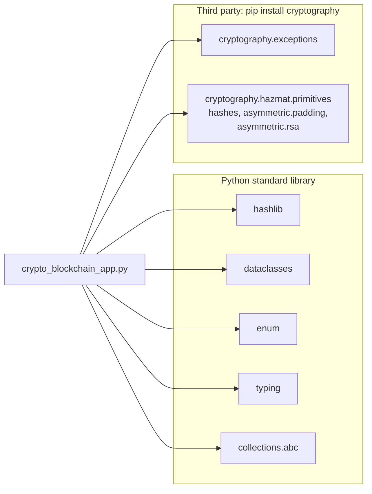

### Design decisions

| Decision                                                | Rationale                                                                                                            |
| ------------------------------------------------------- | -------------------------------------------------------------------------------------------------------------------- |
| One module with four clearly separated sections         | Easy to submit, run and review; the console layer depends on the service layer only                                  |
| Services without any `print` or `input`                 | `sha256_hex`, `SignatureScheme` and `VehicleRegistry` can be used and tested without console interaction             |
| `MenuOption` as an `IntEnum`                            | No magic numbers; `MenuOption(int(text))` validates the range in one expression and raises `ValueError` otherwise    |
| Dispatch table `_handlers`                              | The loop body does not depend on the number of menu entries and contains no `if`/`elif` ladder                       |
| Frozen, slotted dataclasses for `Vehicle` and `KeyPair` | Records are immutable and compact, so a registered vehicle cannot be altered afterwards                              |
| Domain exceptions instead of sentinel return values     | Errors cannot be ignored silently, and the console layer alone decides how they are worded                           |
| Canonical number-plate key                              | Duplicate detection and lookups are robust against differences in case and spacing                                   |
| Duplicate check before the owner and model prompts      | The user is not asked for data that would be rejected anyway                                                         |
| RSASSA-PSS instead of PKCS #1 v1.5                      | Probabilistic padding with a security proof in the random-oracle model; RFC 8017 recommends PSS for new applications |
| 2048-bit modulus and e = 65537                          | Roughly 112 bits of security strength and a cheap public-key operation                                               |
| Salt length equal to the digest length                  | hLen is one of the two typical salt lengths named in RFC 8017, the other being 0                                     |
| Explicit UTF-8 encoding of messages                     | Digest and signature do not depend on platform defaults                                                              |
| Fresh key pair for every run of menu entry 2            | The assignment places key generation inside the signature feature, and no key material is stored                     |

## Code reference

| Symbol                  | Kind             | Responsibility                                                                                                   |
| ----------------------- | ---------------- | ---------------------------------------------------------------------------------------------------------------- |
| `sha256_hex(message)`   | function         | UTF-8 encodes a string and returns its SHA-256 digest as 64 hexadecimal digits                                   |
| `KeyPair`               | frozen dataclass | Holds an RSA `private_key` and the matching `public_key`                                                         |
| `SignatureScheme`       | stateless class  | RSASSA-PSS with `generate_key_pair()`, `sign(private_key, message)` and `verify(public_key, message, signature)` |
| `VehicleRegistryError`  | exception        | Base class of all registry errors                                                                                |
| `DuplicateVehicleError` | exception        | Raised when a number plate is already registered                                                                 |
| `VehicleNotFoundError`  | exception        | Raised when no vehicle has the requested number plate                                                            |
| `Vehicle`               | frozen dataclass | Immutable record with `number_plate`, `owner` and `model`                                                        |
| `VehicleRegistry`       | class            | Dictionary-backed store with `canonical()`, `ensure_available()`, `register()` and `get()`                       |
| `MenuOption`            | `IntEnum`        | The five menu entries and the numbers the user types                                                             |
| `MENU_LABELS`           | constant mapping | The text displayed for each menu entry                                                                           |
| `read_required(prompt)` | function         | Repeats the prompt until a non-blank value is entered and returns it stripped                                    |
| `Application`           | class            | The menu loop (`run`), menu rendering, choice parsing and the four action handlers                               |
| `main()`                | function         | Starts the application and handles Ctrl+C and the end of input                                                   |

## Complexity analysis

Let $n$ denote the length of a message in bytes, $L$ the length of a number plate and $N$ the number of registered vehicles.

| Operation                             | Time                      | Space            | Remark                                                                                                   |
| ------------------------------------- | ------------------------- | ---------------- | -------------------------------------------------------------------------------------------------------- |
| `sha256_hex`                          | O(n)                      | O(n)             | One compression call per 64-byte block; the UTF-8 copy dominates memory use                              |
| `generate_key_pair`                   | randomised                | O(1)             | Dominated by the search for two 1024-bit primes; the slowest step of the program                         |
| `sign`                                | one private-key operation | O(1)             | One modular exponentiation with a 2048-bit modulus, accelerated by the Chinese remainder theorem         |
| `verify`                              | one public-key operation  | O(1)             | With e = 65537 the exponentiation needs only 16 squarings and 1 multiplication, far cheaper than signing |
| `register`, `ensure_available`, `get` | O(L) expected             | O(L) per vehicle | Canonicalising and hashing the plate costs O(L); the dictionary lookup is O(1) on average in N           |
| Whole registry                        |                           | O(N·L)           | One record per registered vehicle                                                                        |

## Test matrix

The cases below cover every branch of the program. Each one can be replayed interactively, or non-interactively by piping the answers, one per line, into the program.

```bash
printf '%s\n' 1 abc 5 | python crypto_blockchain_app.py
```

| ID  | Scenario                                         | Input, one entry per line                        | Expected result                                                                                                         |
| --- | ------------------------------------------------ | ------------------------------------------------ | ----------------------------------------------------------------------------------------------------------------------- |
| T01 | Invalid menu choices                             | `9`, `abc`, an empty line                        | `Invalid choice. Enter a number from 1 to 5.` for each, and the menu is printed again                                   |
| T02 | Known SHA-256 vector                             | `1`, `abc`                                       | `SHA-256: ba7816bf8f01cfea414140de5dae2223b00361a396177a9cb410ff61f20015ad`                                             |
| T03 | SHA-256 of the empty message                     | `1`, an empty line                               | `SHA-256: e3b0c44298fc1c149afbf4c8996fb92427ae41e4649b934ca495991b7852b855`                                             |
| T04 | Sign and verify                                  | `2`, `my message`                                | `Public-private key pair generated (RSA-2048).`, a signature of 512 hexadecimal digits, `Signature verification: VALID` |
| T05 | Register a vehicle                               | `3`, `WB01AB1234`, `Riya Sen`, `Hyundai i20`     | `Vehicle WB01AB1234 registered successfully.`                                                                           |
| T06 | Exact duplicate                                  | `3`, `WB01AB1234`                                | `Error: Number plate 'WB01AB1234' is already registered.`, and no owner or model prompt                                 |
| T07 | Duplicate that differs in case and spacing       | `3`, `wb 01 ab 1234`                             | The same duplicate error                                                                                                |
| T08 | Retrieve an existing vehicle, case-insensitively | `4`, `wb01ab1234`                                | `Number Plate: WB01AB1234`, `Owner:        Riya Sen`, `Model:        Hyundai i20`                                       |
| T09 | Retrieve an unknown vehicle                      | `4`, `XX99`                                      | `Error: No vehicle found with number plate 'XX99'.`                                                                     |
| T10 | Blank field                                      | `3`, an empty line                               | `  This field cannot be empty. Please try again.`, then the prompt is repeated                                          |
| T11 | Exit                                             | `5`                                              | `Goodbye!` and the program ends                                                                                         |
| T12 | Interrupt or end of input                        | Ctrl+C, or Ctrl+D (Ctrl+Z then Enter on Windows) | A line break, then `Input terminated. Goodbye!`                                                                         |

## Troubleshooting

| Symptom                                                             | Cause                                                                 | Remedy                                                                                 |
| ------------------------------------------------------------------- | --------------------------------------------------------------------- | -------------------------------------------------------------------------------------- |
| `ModuleNotFoundError: No module named 'cryptography'`               | The package is not installed for the interpreter that runs the script | `python -m pip install cryptography`, using the same `python` that runs the program    |
| `TypeError: dataclass() got an unexpected keyword argument 'slots'` | The interpreter is older than Python 3.10                             | Install Python 3.10 or newer and check it with `python --version`                      |
| `python: command not found`                                         | Only `python3` is on the PATH                                         | Run `python3 crypto_blockchain_app.py`, or `py -3 crypto_blockchain_app.py` on Windows |
| A short pause after choosing entry 2                                | RSA key generation is a randomised search for two large primes        | No action needed; the pause is normal                                                  |

## Scope and limitations

The project deliberately stays within the scope of the assignment. Vehicle records live in an ordinary in-memory dictionary, so they disappear when the program ends. The key pair of menu entry 2 is generated for that single action, is neither printed nor written to disk, and is discarded afterwards. Because the menu action signs and verifies the same unmodified message with the matching key pair, the verdict it displays is always `VALID`; the failing paths of `SignatureScheme.verify()` can be reproduced with the snippet in the section on the digital signature. Number plates are compared ignoring case and whitespace only, so `WB-01-AB-1234` and `WB01AB1234` are treated as different plates. Finally, no blockchain data structure is implemented: the registry is a dictionary, not a ledger.

## References

| Ref. | Source                                                                                                                                | Used for                                         |
| ---- | ------------------------------------------------------------------------------------------------------------------------------------- | ------------------------------------------------ |
| [1]  | NIST, [FIPS 180-4: Secure Hash Standard](https://nvlpubs.nist.gov/nistpubs/FIPS/NIST.FIPS.180-4.pdf), 2015                            | Specification of SHA-256                         |
| [2]  | [RFC 8017: PKCS #1, RSA Cryptography Specifications Version 2.2](https://www.rfc-editor.org/rfc/rfc8017), 2016                        | RSASSA-PSS, EMSA-PSS and MGF1                    |
| [3]  | M. Bellare and P. Rogaway, *The Exact Security of Digital Signatures: How to Sign with RSA and Rabin*, EUROCRYPT 1996                 | Design and security proof of PSS                 |
| [4]  | J.-S. Coron, *Optimal Security Proofs for PSS and Other Signature Schemes*, EUROCRYPT 2002                                            | Tight security reduction for PSS                 |
| [5]  | E. Barker, [NIST SP 800-57 Part 1 Rev. 5: Recommendation for Key Management](https://csrc.nist.gov/pubs/sp/800/57/pt1/r5/final), 2020 | Security strength of 2048-bit RSA                |
| [6]  | [`cryptography` documentation: RSA](https://cryptography.io/en/latest/hazmat/primitives/asymmetric/rsa/)                              | Key generation, PSS signing and verification API |
| [7]  | [Python documentation: `hashlib`](https://docs.python.org/3/library/hashlib.html)                                                     | SHA-256 API                                      |