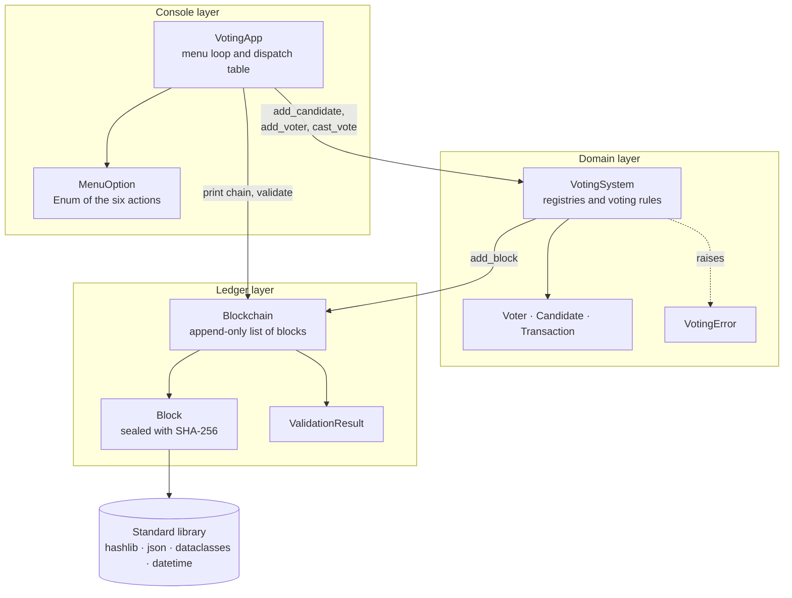
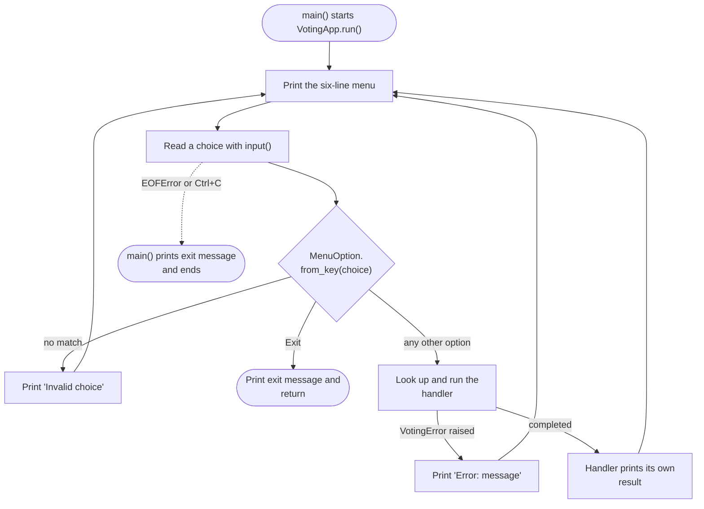
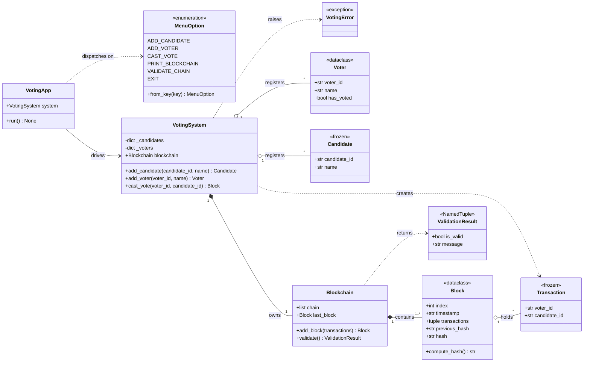
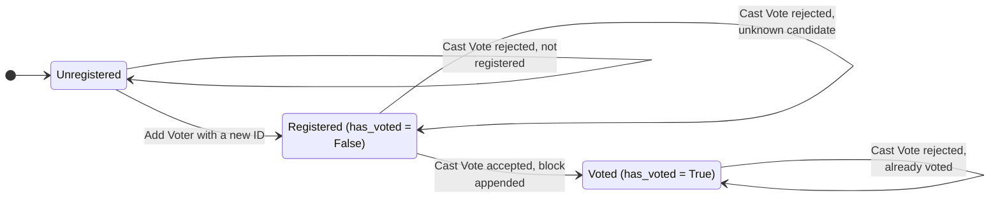
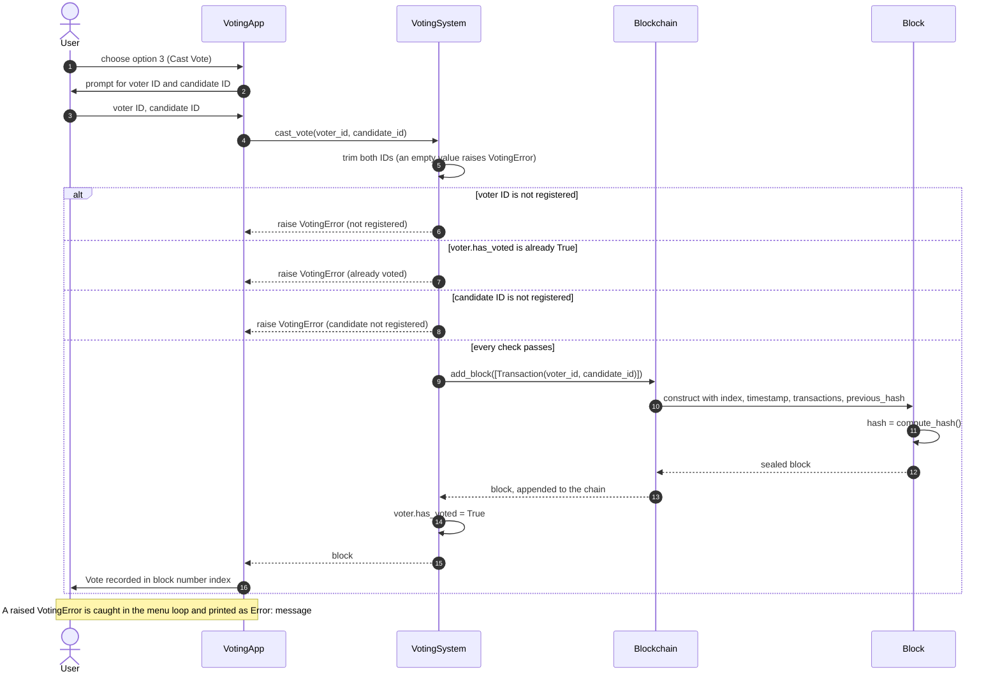
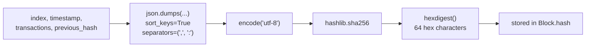
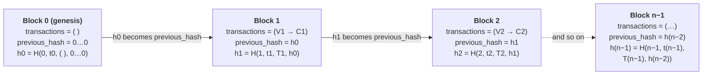
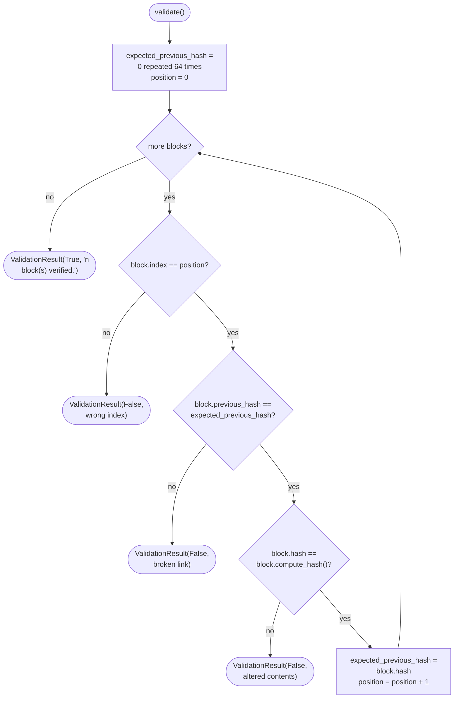
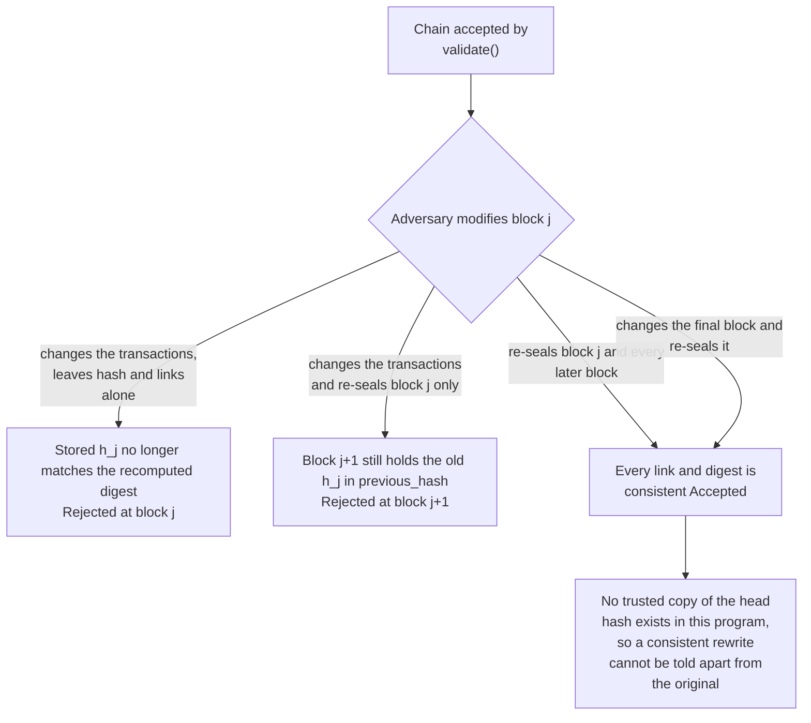

# Voting Management System on a Simple Blockchain

A menu-driven console application in which every vote is sealed into a SHA-256 hash-linked block. It is written in Python, uses only the standard library, and lives in a single module, `voting_blockchain.py`.

[Overview](#overview) · [Requirements coverage](#requirements-coverage) · [Quick start](#quick-start) · [Using the application](#using-the-application) · [Architecture](#architecture) · [Menu control flow](#menu-control-flow) · [Domain model](#domain-model) · [Voting rules and input validation](#voting-rules-and-input-validation) · [The ledger](#the-ledger) · [Chain validation](#chain-validation) · [Integrity analysis](#integrity-analysis) · [Design decisions](#design-decisions) · [Scope and limitations](#scope-and-limitations) · [Repository layout](#repository-layout)

## Overview

The program keeps two registries, one of voters and one of candidates, together with an append-only ledger. An administrator registers candidates and voters, and a registered voter then casts a single vote for any registered candidate. The vote is recorded as a transaction $(v \rightarrow c)$ inside a newly created block. Every block stores the hash of its predecessor as well as its own SHA-256 hash, which covers the block's index, its timestamp, its transactions and that back-pointer. Altering a recorded vote therefore changes a hash on which every later block already depends, and the *Validate Chain* action exposes the inconsistency by recomputing all hashes from the stored data.

The interface is a loop that redisplays a six-option menu after every action: add a candidate, add a voter, cast a vote, print the blockchain, validate the chain, and exit. Duplicate voter IDs, duplicate candidate IDs and double voting are rejected before the ledger is touched, so the chain contains accepted votes only.

## Requirements coverage

The table maps each requirement of the assignment to the code that satisfies it.

| Requirement                                                             | Implementation                                                |
| ----------------------------------------------------------------------- | ------------------------------------------------------------- |
| Entity `Voter` with `voter_id`, `name`, `has_voted`                     | `Voter` dataclass                                             |
| Entity `Candidate` with `candidate_id`, `name`                          | `Candidate` dataclass                                         |
| Menu inside a loop, shown every time, offering the six required options | `MenuOption`, `VotingApp.run`                                 |
| Add Candidate and Add Voter                                             | `VotingSystem.add_candidate`, `VotingSystem.add_voter`        |
| Cast Vote (voter → any candidate)                                       | `VotingSystem.cast_vote`, one block per accepted vote         |
| Print Blockchain (blocks, transactions, hashes)                         | `VotingApp._print_blockchain`                                 |
| Validate Chain                                                          | `Blockchain.validate`                                         |
| No duplicate voter IDs, no duplicate candidate IDs, no double voting    | ID-keyed dictionaries and `Voter.has_voted` in `VotingSystem` |
| Exit                                                                    | `MenuOption.EXIT` ends the loop                               |

## Quick start

The program needs Python 3.8 or newer and nothing else. No installation or configuration is required, because it imports only `hashlib`, `json`, `dataclasses`, `datetime`, `enum`, `collections.abc` and `typing` from the standard library. It has been run successfully on Python 3.8, 3.9, 3.10 and 3.12.

```bash
python voting_blockchain.py
```

Use `python3` on systems where `python` does not refer to Python 3. For a non-interactive run, supply the menu choices and field values on standard input. The command below registers a candidate and a voter, casts the vote, prints the chain, validates it, and exits.

```bash
printf '1\nC1\nAlice\n2\nV1\nAnn\n3\nV1\nC1\n4\n5\n6\n' | python voting_blockchain.py
```

All state is held in memory and is discarded when the program exits.

## Using the application

Every iteration of the loop prints the menu and prompts for a choice.

```text
===== Voting Management System =====
1. Add Candidate
2. Add Voter
3. Cast Vote
4. Print Blockchain
5. Validate Chain
6. Exit
Enter your choice (1-6):
```

Add Candidate and Add Voter each ask for an ID and a name. Both values are trimmed of surrounding whitespace and must be non-empty; IDs are compared as exact, case-sensitive strings, and names need not be unique. Cast Vote asks for the voter's ID and the ID of the candidate being voted for, and on success reports the index of the block that now holds the vote. Print Blockchain lists every block from the genesis block onward. Validate Chain reports either `VALID` together with the number of blocks verified, or `INVALID` together with the first inconsistency found.

The transcripts below were produced by running the program. The six-line menu that precedes every prompt is omitted for brevity. The first transcript registers entities and shows that each rejection rule fires.

```text
Enter your choice (1-6): 1
Candidate ID: C1
Candidate name: Alice
Candidate added: C1 - Alice

Enter your choice (1-6): 1
Candidate ID: C1
Candidate name: Bob
Error: Candidate ID 'C1' already exists.

Enter your choice (1-6): 1
Candidate ID: C2
Candidate name: Bob
Candidate added: C2 - Bob

Enter your choice (1-6): 2
Voter ID: V1
Voter name: Ann
Voter added: V1 - Ann

Enter your choice (1-6): 2
Voter ID: V1
Voter name: Anna
Error: Voter ID 'V1' already exists.

Enter your choice (1-6): 2
Voter ID: V2
Voter name: Ben
Voter added: V2 - Ben

Enter your choice (1-6): 2
Voter ID:
Voter name: X
Error: Voter ID cannot be empty.
```

The second transcript casts votes, including every way in which a vote can be refused, and then enters a menu key that does not exist.

```text
Enter your choice (1-6): 3
Voter ID: V1
Candidate ID to vote for: C1
Vote recorded in block #1.

Enter your choice (1-6): 3
Voter ID: V1
Candidate ID to vote for: C2
Error: Voter 'V1' has already voted.

Enter your choice (1-6): 3
Voter ID: V9
Candidate ID to vote for: C1
Error: Voter ID 'V9' is not registered.

Enter your choice (1-6): 3
Voter ID: V2
Candidate ID to vote for: C9
Error: Candidate ID 'C9' is not registered.

Enter your choice (1-6): 3
Voter ID: V2
Candidate ID to vote for: C2
Vote recorded in block #2.

Enter your choice (1-6): 9
Invalid choice. Please enter a number from 1 to 6.
```

The third transcript prints and validates the resulting chain. Timestamps and hashes differ from run to run, because the timestamp is part of the hashed data.

```text
Enter your choice (1-6): 4

Block #0 (Genesis)
  Timestamp     : 2026-10-04T08:29:33+00:00
  Transactions  : 0
  Previous Hash : 0000000000000000000000000000000000000000000000000000000000000000
  Hash          : bd943856863a66ec16bd89c9f553c7a81a80979ffb7504aae0875b019c985039

Block #1
  Timestamp     : 2026-10-04T08:29:33+00:00
  Transactions  : 1
      Voter V1 -> Candidate C1
  Previous Hash : bd943856863a66ec16bd89c9f553c7a81a80979ffb7504aae0875b019c985039
  Hash          : c29bd9e60a281e39b1b9d252faf0050e05aeaac3b4e3784374b17b259a359a7e

Block #2
  Timestamp     : 2026-10-04T08:29:33+00:00
  Transactions  : 1
      Voter V2 -> Candidate C2
  Previous Hash : c29bd9e60a281e39b1b9d252faf0050e05aeaac3b4e3784374b17b259a359a7e
  Hash          : a908bf3782d9cf322e008cdea41be7bd6314f8b53e18b236daa273c04c6b064a

Enter your choice (1-6): 5
Chain status: VALID. 3 block(s) verified.
```

## Architecture

The program is organised in three layers whose dependencies point downwards. The console layer (`MenuOption`, `VotingApp` and the `main` entry point) is the only code that reads standard input or writes standard output. The domain layer (`VotingSystem`, `Voter`, `Candidate`, `Transaction`, `VotingError`) holds the registries and enforces every voting rule without performing any input or output. The ledger layer (`Blockchain`, `Block`, `ValidationResult`) knows nothing about registries or rules: it receives transactions, seals them into blocks, and can verify its own integrity. Keeping the rules out of the console and the console out of the rules makes each layer easy to read and to test in isolation.



## Menu control flow

At the top of every iteration the application prints the six-line menu, reads a choice, and resolves it with `MenuOption.from_key`. An unrecognised key prints an error message and starts the next iteration. The Exit option terminates the loop. Any other option is dispatched to its handler inside a `try` block that converts a `VotingError` into a one-line `Error: ...` message, so a rejected operation neither terminates the program nor changes any state. End of input and Ctrl+C are intercepted in `main`, which prints the exit message instead of a traceback.



## Domain model

`Voter` is the only mutable entity: its `has_voted` flag starts as `False` and is switched exactly once. `Candidate` and `Transaction` are frozen dataclasses, that is, value objects whose fields cannot be reassigned after construction. A `Transaction` is the on-chain record of one vote and carries only the pair `(voter_id, candidate_id)`. A `Block` stores its index, an ISO-8601 UTC timestamp, a tuple of transactions, the previous block's hash and its own hash, which `__post_init__` derives from the other four fields. `Block` is deliberately an ordinary, non-frozen dataclass so that tampering can be simulated from a Python shell and shown to be detected; the application itself never modifies a block after construction.

`Blockchain` owns the list of blocks, creates the genesis block, appends new blocks and validates the chain, returning a `ValidationResult` named tuple. `VotingSystem` owns the two registries, which are plain dictionaries keyed by ID, together with the ledger, and it is the only place where voting rules are enforced. Every rule violation is reported through `VotingError`. `MenuOption` is an `Enum` whose members carry their key and label, and `VotingApp` maps each member to a handler method through a dispatch dictionary.



## Voting rules and input validation

### Voter lifecycle

A voter ID passes through at most three states. It is unregistered until Add Voter succeeds, registered with `has_voted = False` until a vote is accepted, and registered with `has_voted = True` thereafter. The state machine has no transition out of the last state, which is precisely the "no double voting" rule.



### Rejection conditions

The first three rules in the table are those required by the assignment. The remaining four are the minimum guards needed for an ID, a vote or a menu key to be meaningful at all. Every rejection is raised before the ledger is touched, so a refused operation leaves both the registries and the chain unchanged.

| Rule                                             | Enforced in                                         | Message shown                                        |
| ------------------------------------------------ | --------------------------------------------------- | ---------------------------------------------------- |
| Voter IDs are unique                             | `VotingSystem.add_voter`                            | `Error: Voter ID 'V1' already exists.`               |
| Candidate IDs are unique                         | `VotingSystem.add_candidate`                        | `Error: Candidate ID 'C1' already exists.`           |
| A voter votes at most once                       | `VotingSystem.cast_vote`, through `Voter.has_voted` | `Error: Voter 'V1' has already voted.`               |
| The voter must be registered                     | `VotingSystem.cast_vote`                            | `Error: Voter ID 'V9' is not registered.`            |
| The candidate must be registered                 | `VotingSystem.cast_vote`                            | `Error: Candidate ID 'C9' is not registered.`        |
| IDs and names must be non-empty                  | `VotingSystem._required`                            | `Error: Voter ID cannot be empty.`                   |
| The menu key must be one of the six defined keys | `MenuOption.from_key`                               | `Invalid choice. Please enter a number from 1 to 6.` |

Inside `cast_vote` the checks run in a fixed order: emptiness, voter registration, `has_voted`, candidate registration. A request that violates several rules at once is therefore reported for the first violated rule only.

The system maintains a simple but important invariant. Let $V$ be the set of registered voters, $T$ the multiset of transactions on the chain, $\operatorname{voter}(\tau)$ the voter ID recorded in a transaction $\tau$, and $\operatorname{voted}(v)$ the value of `has_voted` for a voter $v$ with ID $\operatorname{id}(v)$. Then

$$
\forall v \in V:\quad \bigl|\{\tau \in T : \operatorname{voter}(\tau) = \operatorname{id}(v)\}\bigr| =
\begin{cases}
1, & \operatorname{voted}(v),\\
0, & \text{otherwise.}
\end{cases}
$$

The invariant holds initially, because there are no voters and no transactions, and every action preserves it. Add Voter introduces a voter with `has_voted = False` and no transaction. A rejected Cast Vote changes neither the chain nor any flag. An accepted Cast Vote is possible only for a voter whose flag is `False`; it appends exactly one transaction for that voter and only afterwards sets the flag. No voter can therefore ever be associated with more than one transaction, which is the formal content of "no double voting". Setting the flag after the block has been appended also guarantees that a failure while sealing a block cannot leave a voter marked as having voted without a matching transaction.

### Anatomy of Cast Vote



## The ledger

### Block structure and hashing

Let $H$ denote SHA-256 and let $\operatorname{hex}$ map a 256-bit digest to its 64-character lowercase hexadecimal string. For a block $B_i$ with index $i$, timestamp $t_i$, transaction tuple $T_i = (\tau_{i,1}, \dots, \tau_{i,m_i})$ and back-pointer $p_i$, the stored hash is

$$
h_i = \operatorname{hex}\bigl(H(\operatorname{Enc}(i, t_i, T_i, p_i))\bigr),
\qquad
p_i =
\begin{cases}
0^{64}, & i = 0,\\
h_{i-1}, & i \ge 1,
\end{cases}
$$

where $0^{64}$ is the string of sixty-four zero characters (`GENESIS_PREVIOUS_HASH`). The function $\operatorname{Enc}$ serialises the four fields as a JSON object with sorted keys, no insignificant whitespace and ASCII escaping, and encodes the resulting text as UTF-8. The genesis block $B_0$ has an empty transaction tuple and is created in `Blockchain.__init__`, so the chain is never empty and `last_block` is always defined.



Two properties of this encoding matter. It is deterministic, so recomputing a hash during validation reproduces the original digest bit for bit. It is also injective on the data being hashed, so two different blocks can never be serialised to the same string. Plain concatenation lacks the second property: the voter and candidate pairs `("V1", "2C")` and `("V12", "C")` both concatenate to `V12C`, whereas their JSON encodings differ because the delimiters are part of the text.

The following is a complete worked example. Block 1 of the session shown above is serialised as

```json
{"index":1,"previous_hash":"bd943856863a66ec16bd89c9f553c7a81a80979ffb7504aae0875b019c985039","timestamp":"2026-10-04T08:29:33+00:00","transactions":[{"candidate_id":"C1","voter_id":"V1"}]}
```

and its hash can be reproduced independently of the application:

```python
>>> import hashlib
>>> payload = '{"index":1,"previous_hash":"bd943856863a66ec16bd89c9f553c7a81a80979ffb7504aae0875b019c985039","timestamp":"2026-10-04T08:29:33+00:00","transactions":[{"candidate_id":"C1","voter_id":"V1"}]}'
>>> hashlib.sha256(payload.encode("utf-8")).hexdigest()
'c29bd9e60a281e39b1b9d252faf0050e05aeaac3b4e3784374b17b259a359a7e'
```

### Chain structure

Each block copies the hash of its predecessor into its own `previous_hash` field and then hashes itself, so the hash of every block depends, through the chain of back-pointers, on the contents of every earlier block.



## Chain validation

`Blockchain.validate` never trusts a stored hash. For every block, in order, it checks that the stored index equals the block's position, that the stored back-pointer equals the hash of the preceding block (the sentinel for the genesis block), and that recomputing the hash from the block's current contents reproduces the stored hash. The first failed check ends the scan and is reported in the returned `ValidationResult`. Formally, for a chain $(B_0, \dots, B_{n-1})$,

$$
\begin{aligned}
\operatorname{Valid}(B_0, \dots, B_{n-1}) \iff \forall i \in \{0, \dots, n-1\}:\quad
& \mathrm{index}(B_i) = i, \\
& p_i = h_{i-1} \quad (h_{-1} := 0^{64}), \\
& h_i = \operatorname{hex}\bigl(H(\operatorname{Enc}(i, t_i, T_i, p_i))\bigr).
\end{aligned}
$$



Let $n$ be the number of blocks, $v$ the number of voters and $c$ the number of candidates. Validation evaluates $H$ at most $n$ times and uses constant auxiliary space, so it runs in $O(n)$ time and $O(1)$ extra space. Registering a voter or a candidate costs expected $O(1)$ time, because the registries are dictionaries. Cast Vote costs a constant number of dictionary lookups plus one evaluation of $H$ on a payload whose length is bounded by the lengths of the two IDs. Print Blockchain is $O(n)$, and the memory footprint of the whole program is $O(v + c + n)$.

## Integrity analysis

Treat $H$ as second-preimage resistant: given $x$, finding $x' \neq x$ with $H(x') = H(x)$ is computationally infeasible. Idealising $H$ as a random oracle, an adversary who evaluates it on $q$ candidate inputs succeeds with probability at most $q \cdot 2^{-256}$.

**Proposition 1 (an inconsistent edit is detected where it was made).** Let $(B_0, \dots, B_{n-1})$ be a valid chain, and let $C'$ be obtained by replacing $(t_j, T_j)$ with some $(t_j', T_j') \neq (t_j, T_j)$ in a single block $B_j$ while leaving every stored $p_i$ and $h_i$ untouched. Then $\operatorname{Valid}(C')$ is false, except with probability at most $q \cdot 2^{-256}$.

*Proof.* Because $\operatorname{Enc}$ is injective, $x' = \operatorname{Enc}(j, t_j', T_j', p_j)$ differs from $x = \operatorname{Enc}(j, t_j, T_j, p_j)$. The third condition at position $j$ demands $\operatorname{hex}(H(x')) = h_j = \operatorname{hex}(H(x))$, that is, $H(x') = H(x)$ with $x' \neq x$, which is a second preimage of $H(x)$. ∎

**Proposition 2 (re-sealing a block relocates the inconsistency).** Suppose in addition that the adversary replaces $h_j$ by $h_j' = \operatorname{hex}(H(x'))$ and that $j < n-1$. Then $\operatorname{Valid}(C')$ is false, except with probability at most $q \cdot 2^{-256}$.

*Proof.* If $h_j' = h_j$, then $x'$ would again be a second preimage of $H(x)$. Otherwise $h_j' \neq h_j = p_{j+1}$, so the second condition fails at position $j+1$. ∎



> [!IMPORTANT]
> Validate Chain is a consistency check, not a defence against an adversary who can rewrite the whole ledger. To obtain a chain that passes, such an adversary recomputes $h_j', p_{j+1}', h_{j+1}', \dots, h_{n-1}'$, which costs $n - j$ evaluations of $H$ and a few microseconds in this program because no proof of work is required. Re-sealing the final block is even simpler, since no successor exists to disagree with it. Making such rewrites detectable requires an external copy of the head hash $h_{n-1}$ or replication across independent parties, which lies outside the scope of this assignment.

### Demonstrating tamper detection

The menu deliberately offers no way to modify a recorded vote, so tampering is demonstrated from a Python shell opened in the directory that contains `voting_blockchain.py`.

```python
import voting_blockchain as vb

system = vb.VotingSystem()
for cid, name in (("C1", "Alice"), ("C2", "Bob")):
    system.add_candidate(cid, name)
for vid, name in (("V1", "Ann"), ("V2", "Ben"), ("V3", "Cy")):
    system.add_voter(vid, name)
system.cast_vote("V1", "C1")
system.cast_vote("V2", "C2")
system.cast_vote("V3", "C1")

chain = system.blockchain
print(chain.validate())                                  # honest chain

block = chain.chain[2]
block.transactions = (vb.Transaction("V2", "C1"),)       # rewrite a recorded vote
print(chain.validate())                                  # contents no longer match the stored hash

block.hash = block.compute_hash()                        # re-seal the edited block
print(chain.validate())                                  # the next block's back-pointer disagrees
```

```text
ValidationResult(is_valid=True, message='4 block(s) verified.')
ValidationResult(is_valid=False, message='Block #2 has been altered: its stored hash does not match its contents.')
ValidationResult(is_valid=False, message='Block #3 is not linked to the hash of the block before it.')
```

## Design decisions

Each accepted vote is sealed into its own block immediately. The specification offers no action for mining or committing pending transactions, so a pool of unconfirmed votes would add behaviour that nobody can trigger, whereas one block per vote keeps the ledger a faithful, ordered record of accepted votes. The `transactions` field is nevertheless a tuple, so a block could carry several transactions without any change to the hashing scheme. Hashing uses canonical JSON rather than string concatenation because JSON is deterministic and injective, as argued above. No proof of work is used: the assignment asks for a simple blockchain, and proof of work would introduce a difficulty parameter and a nonce that no menu action could use.

The registries are dictionaries keyed by ID, which turns every duplicate or existence check into an expected constant-time lookup. The rules live in `VotingSystem`, which raises `VotingError` instead of printing, so the same rules would apply unchanged behind a different interface. `Voter.has_voted` is switched only after the block has been appended. `Voter` is the only mutable entity, while `Candidate` and `Transaction` are frozen so that recorded data cannot be altered by accident.

The menu is an `Enum` whose members carry their key and label, and the menu lines and the accepted keys are derived from the same members. Handlers are found through a dispatch dictionary instead of a chain of conditionals, so the loop itself does not change when an action is added. The loop catches `VotingError` only; any other exception indicates a programming error and is deliberately allowed to surface. Type hints are used throughout, and `from __future__ import annotations` keeps them lazily evaluated, which is what allows the modern generic syntax in annotations to run unchanged on Python 3.8.

## Scope and limitations

The application is a teaching model of a blockchain-backed ballot box and deliberately implements only the behaviour that the assignment specifies. State is held in memory, so the registries and the chain vanish when the program exits. There is no authentication: the administrative actions Add Candidate and Add Voter are available to whoever runs the program, and a voter is identified solely by an ID. There is no network, consensus or proof of work, so the guarantee offered by Validate Chain is exactly the one analysed above and no stronger. Because each transaction pairs the voter's ID with the candidate's ID, as the voter-to-candidate transaction model of the assignment suggests, the ledger provides integrity but not ballot secrecy. The menu contains no tally; vote counts can be read from the transactions displayed by Print Blockchain. Timestamps have one-second resolution and are informational, since the order of blocks is fixed by their position in the chain and not by the clock.

## Repository layout

```text
.
├── voting_blockchain.py   # the complete application
└── README.md              # this document
```